# Data Model — LeaveWise

PostgreSQL schema. All `id` columns are `BIGINT GENERATED ALWAYS AS IDENTITY`.
Migrations: a single `V1__init.sql` creates the whole schema described here (§7). Until the first deploy, schema changes edit V1 and this document; afterwards, every change is a new migration (`SPEC.md` §0).
Notation: `PK` primary key, `FK` foreign key, `UK` unique (alone or as part of a composite unique; see §2).

## 1. Entity-Relationship Diagram

```mermaid
erDiagram
    company {
        bigint id PK
        varchar(200) name UK "NOT NULL"
        timestamp created_at "NOT NULL, default now"
        timestamp updated_at "nullable"
    }

    municipality {
        bigint id PK
        varchar(150) name UK "NOT NULL; UK(name, district, country), case-insensitive"
        varchar(150) district UK "NOT NULL"
        varchar(100) country UK "NOT NULL"
    }

    company_location {
        bigint id PK
        bigint company_id FK,UK "NOT NULL; UK(company_id, id)"
        bigint municipality_id FK "NOT NULL"
        varchar(150) name UK "NOT NULL; UK(company_id, name)"
        varchar(500) address "nullable"
    }

    lw_user {
        bigint id PK
        varchar(200) name "NOT NULL"
        varchar(9) nif UK "nullable"
        varchar(320) email UK "NOT NULL"
        varchar(255) password_hash "NOT NULL"
        varchar(30) role "NOT NULL, default USER; USER|ADMIN"
        varchar(50) contact "nullable"
        bigint company_id FK "NOT NULL"
        bigint company_location_id FK "NOT NULL; composite FK with company_id"
        boolean is_active "NOT NULL, default true"
        timestamp created_at "NOT NULL, default now"
        timestamp updated_at "nullable"
    }

    work_schedule {
        bigint id PK
        bigint company_id FK,UK "NOT NULL; one schedule per company"
        varchar(150) name "NOT NULL"
    }

    work_schedule_day {
        bigint id PK
        bigint work_schedule_id FK,UK "NOT NULL; UK(work_schedule_id, day_of_week)"
        smallint day_of_week UK "NOT NULL; 1..7"
        boolean is_working_day "NOT NULL"
    }

    holiday {
        bigint id PK
        date date "NOT NULL"
        varchar(200) name "NOT NULL"
        varchar(30) type "NOT NULL; NATIONAL|MUNICIPAL|OTHER"
        bigint municipality_id FK "nullable"
    }

    vacation_policy {
        bigint id PK
        bigint company_id FK,UK "NOT NULL; UK(company_id, year)"
        smallint year UK "NOT NULL; > 2020"
        integer annual_days "NOT NULL; > 0"
        boolean carry_over_allowed "NOT NULL, default true"
        date carry_over_expiry_date "nullable"
    }

    vacation_entitlement {
        bigint id PK
        bigint user_id FK,UK "NOT NULL; UK(user_id, year)"
        smallint year UK "NOT NULL; > 2020"
        integer annual_days "NOT NULL; >= 0"
        integer carried_over_days "NOT NULL, default 0; >= 0"
        date carried_over_expiry_date "nullable"
    }

    vacation {
        bigint id PK
        bigint user_id FK "NOT NULL"
        date start_date "NOT NULL"
        date end_date "NOT NULL; >= start_date"
        integer days "NOT NULL; > 0"
        varchar(30) status "NOT NULL, default PENDING; PENDING|ACCEPTED|REJECTED|CANCELLED"
        timestamp created_at "NOT NULL, default now"
        timestamp updated_at "nullable"
    }

    vacation_suggestion {
        bigint id PK
        bigint user_id FK "NOT NULL"
        smallint year "NOT NULL; > 2020"
        date start_date "NOT NULL"
        date end_date "NOT NULL; >= start_date"
        date block_start_date "NOT NULL; <= start_date"
        date block_end_date "NOT NULL; >= end_date"
        integer days "NOT NULL; > 0"
        text reason "nullable"
        varchar(30) status "NOT NULL, default SUGGESTED; SUGGESTED|ACCEPTED|DISMISSED"
        timestamp created_at "NOT NULL, default now"
    }

    file {
        bigint id PK
        bigint user_id FK "NOT NULL"
        varchar(255) file_name "NOT NULL"
        varchar(100) content_type "NOT NULL"
        varchar(500) storage_key "NOT NULL"
        timestamp created_at "NOT NULL, default now"
    }

    vacation_import {
        bigint id PK
        bigint user_id FK "NOT NULL"
        bigint file_id FK "NOT NULL"
        varchar(30) status "NOT NULL, default PENDING; PENDING|PROCESSING|COMPLETED|FAILED"
        timestamp processed_at "nullable"
        timestamp created_at "NOT NULL, default now"
        integer total_rows "nullable; >= 0"
        integer imported_rows "nullable; >= 0"
    }

    refresh_token {
        bigint id PK
        bigint user_id FK "NOT NULL"
        char(64) token_hash UK "NOT NULL; SHA-256 hex"
        timestamp expires_at "NOT NULL"
        timestamp revoked_at "nullable"
        timestamp created_at "NOT NULL, default now"
    }

    vacation_import_error {
        bigint id PK
        bigint vacation_import_id FK "NOT NULL"
        integer row_number "NOT NULL; > 0"
        text message "NOT NULL"
    }

    company              ||--o{ company_location      : "has (CASCADE)"
    municipality         ||--o{ company_location      : "locates (RESTRICT)"
    company              ||--o{ lw_user               : "employs (RESTRICT)"
    company_location     ||--o{ lw_user               : "assigns (RESTRICT)"
    company              ||--o| work_schedule         : "defines (CASCADE)"
    work_schedule        ||--o{ work_schedule_day     : "contains (CASCADE)"
    municipality         |o--o{ holiday               : "observes (RESTRICT)"
    company              ||--o{ vacation_policy       : "sets per year (CASCADE)"
    lw_user              ||--o{ vacation_entitlement  : "entitled per year (CASCADE)"
    lw_user              ||--o{ vacation              : "requests (CASCADE)"
    lw_user              ||--o{ vacation_suggestion   : "receives (CASCADE)"
    lw_user              ||--o{ file                  : "uploads (RESTRICT)"
    lw_user              ||--o{ vacation_import       : "starts (CASCADE)"
    file                 ||--o{ vacation_import       : "source of (CASCADE)"
    vacation_import      ||--o{ vacation_import_error : "reports (CASCADE)"
    lw_user              ||--o{ refresh_token         : "holds (CASCADE)"
```



## 2. Relationships and Referential Actions

| Child                 | FK column(s)                      | Parent                            | Cardinality (parent : child) | ON DELETE |
| --------------------- | --------------------------------- | --------------------------------- | ---------------------------- | --------- |
| company_location      | company_id                        | company                           | 1 : 0..N                     | CASCADE   |
| company_location      | municipality_id                   | municipality                      | 1 : 0..N                     | RESTRICT  |
| lw_user               | company_id                        | company                           | 1 : 0..N                     | RESTRICT  |
| lw_user               | (company_id, company_location_id) | company_location (company_id, id) | 1 : 0..N                     | RESTRICT  |
| work_schedule         | company_id (UNIQUE)               | company                           | 1 : 0..1                     | CASCADE   |
| work_schedule_day     | work_schedule_id                  | work_schedule                     | 1 : 0..7                     | CASCADE   |
| holiday               | municipality_id (nullable)        | municipality                      | 0..1 : 0..N                  | RESTRICT  |
| vacation_policy       | company_id                        | company                           | 1 : 0..N (one per year)      | CASCADE   |
| vacation_entitlement  | user_id                           | lw_user                           | 1 : 0..N (one per year)      | CASCADE   |
| vacation              | user_id                           | lw_user                           | 1 : 0..N                     | CASCADE   |
| vacation_suggestion   | user_id                           | lw_user                           | 1 : 0..N                     | CASCADE   |
| file                  | user_id                           | lw_user                           | 1 : 0..N                     | RESTRICT  |
| vacation_import       | user_id                           | lw_user                           | 1 : 0..N                     | CASCADE   |
| vacation_import       | file_id                           | file                              | 1 : 0..N                     | CASCADE   |
| vacation_import_error | vacation_import_id                | vacation_import                   | 1 : 0..N                     | CASCADE   |
| refresh_token         | user_id                           | lw_user                           | 1 : 0..N                     | CASCADE   |

## 3. Unique Constraints

| Table                | Columns                         | Meaning                                           |
| -------------------- | ------------------------------- | ------------------------------------------------- |
| company              | name                            | Company names are globally unique                 |
| municipality         | (lower(name), lower(district), lower(country)) | One municipality per name, district and country, ignoring case (unique index) |
| company_location     | (company_id, name)              | Location names are unique within a company        |
| company_location     | (company_id, id)                | Supports the composite FK from lw_user            |
| lw_user              | email                           | One account per email                             |
| lw_user              | nif                             | Portuguese tax ID, unique when present (nullable) |
| work_schedule        | company_id                      | At most one schedule per company                  |
| work_schedule_day    | (work_schedule_id, day_of_week) | One row per weekday per schedule                  |
| vacation_policy      | (company_id, year)              | One policy per company per year                   |
| vacation_entitlement | (user_id, year)                 | One entitlement per user per year                 |
| refresh_token        | token_hash                      | Each stored token hash is unique                  |
| holiday              | (date, municipality_id)         | One holiday per date and scope; `NULLS NOT DISTINCT`, so one national per date |

## 4. Enumerations (CHECK constraints)

| Table.column               | Allowed values                         | Default   |
| -------------------------- | -------------------------------------- | --------- |
| lw_user.role               | USER, ADMIN                            | USER      |
| holiday.type               | NATIONAL, MUNICIPAL, OTHER             | —         |
| vacation.status            | PENDING, ACCEPTED, REJECTED, CANCELLED | PENDING   |
| vacation_suggestion.status | SUGGESTED, ACCEPTED, DISMISSED         | SUGGESTED |
| vacation_import.status     | PENDING, PROCESSING, COMPLETED, FAILED | PENDING   |

## 5. Other Check Constraints

- `work_schedule_day.day_of_week` BETWEEN 1 AND 7
- `vacation_policy.annual_days` > 0; `vacation_entitlement.annual_days` >= 0; `vacation_entitlement.carried_over_days` >= 0
- `year` > 2020 on vacation_policy, vacation_entitlement, vacation_suggestion
- `end_date` >= `start_date` and `days` > 0 on vacation and vacation_suggestion
- `vacation_suggestion.block_start_date` <= `start_date` and `block_end_date` >= `end_date` (the block of consecutive days off around the requested window)
- `vacation_import_error.row_number` > 0
- `vacation_import.total_rows` >= 0 and `vacation_import.imported_rows` >= 0

## 6. Modeling Notes

- **User–location integrity:** the composite FK `lw_user(company_id, company_location_id) → company_location(company_id, id)` guarantees a user's location belongs to the user's own company.
- **Delete behavior:** deleting a company cascades to locations, schedule and policies, but is blocked (RESTRICT) while users exist. Deleting a user cascades to vacations, suggestions, entitlements and imports, but is blocked while the user owns `file` rows.
- **Implicit links (not enforced by FK):**
  - `vacation_entitlement` ↔ `vacation_policy` are related through the user's company + `year`; no FK exists.
  - `vacation` and `vacation_suggestion` have no FK to `vacation_entitlement`; the year is derived from dates (vacation) or stored explicitly (suggestion).
  - Accepting a `vacation_suggestion` has no FK to the resulting `vacation` row.
  - Holidays apply to a company location via `company_location.municipality_id = holiday.municipality_id` (MUNICIPAL), or to all locations when `municipality_id` is NULL (NATIONAL).
  - The consistency between `holiday.type` and `municipality_id` is not enforced in the schema; the service enforces it (BR-6).
- **Refresh tokens:** only the SHA-256 hash of the opaque token is stored. A row is valid while `revoked_at IS NULL` and `expires_at` is in the future; rotation revokes the old row and inserts a new one.
- **Computed values:** `vacation.days` / `vacation_suggestion.days` are stored, not derived; they're expected to be working days per the company `work_schedule_day` rows minus applicable holidays. Holiday changes recompute not-yet-ended vacations (BR-16).

## 7. Migrations

Location: `backend/src/main/resources/db/migration/`.

`V1__init.sql` creates every table, FK (§2), unique constraint (§3) and CHECK constraint (§4–5) in this document, then these indexes:

```sql
CREATE INDEX idx_refresh_token_user ON refresh_token(user_id);
CREATE INDEX idx_lw_user_company ON lw_user(company_id);
CREATE INDEX idx_vacation_user_start ON vacation(user_id, start_date);
CREATE INDEX idx_vacation_suggestion_user_year ON vacation_suggestion(user_id, year);
CREATE INDEX idx_vacation_import_user ON vacation_import(user_id);
CREATE INDEX idx_holiday_date ON holiday(date);
```

Notable DDL: the municipality uniqueness is a unique expression index on `lower(...)` (case-insensitive), the holiday uniqueness is `UNIQUE NULLS NOT DISTINCT (date, municipality_id)` (PostgreSQL 15+), and `refresh_token.token_hash` is `CHAR(64)` (SHA-256 hex of the opaque token).
